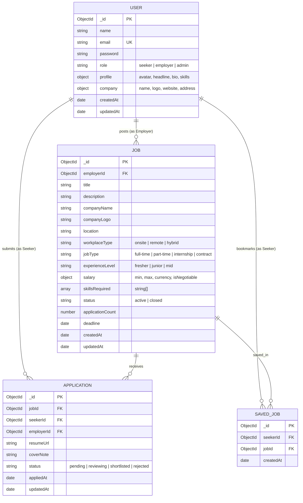

# Database Architecture & Schema Specification (DB.md)

This document defines the data models, relations, field validations, and indexing strategies for the **NextHire** database using **MongoDB & Mongoose**.

---

## 1. Entity Relationship Diagram (ERD)



---

## 2. Detailed Schema Definitions (Mongoose)

### 2.1 User Model (`User.js`)
Stores credentials, roles, and profile information for both Candidates and Employers.

```javascript
import mongoose from 'mongoose';

const userSchema = new mongoose.Schema(
  {
    name: {
      type: String,
      required: [true, 'Please provide your full name'],
      trim: true,
      maxlength: [60, 'Name cannot exceed 60 characters']
    },
    email: {
      type: String,
      required: [true, 'Please provide your email address'],
      unique: true,
      lowercase: true,
      trim: true,
      match: [/^\S+@\S+\.\S+$/, 'Please provide a valid email address']
    },
    password: {
      type: String,
      required: [true, 'Please provide a password'],
      minlength: [6, 'Password must be at least 6 characters'],
      select: false // Excluded from query results by default
    },
    role: {
      type: String,
      enum: {
        values: ['seeker', 'employer', 'admin'],
        message: 'Role must be either seeker or employer'
      },
      default: 'seeker'
    },
    profile: {
      avatar: { type: String, default: '' },
      headline: { type: String, default: '' }, // e.g. "Aspiring MERN Stack Developer"
      bio: { type: String, default: '' },
      phone: { type: String, default: '' },
      resumeUrl: { type: String, default: '' },
      skills: [{ type: String, trim: true }]
    },
    company: {
      name: { type: String, default: '' },
      logo: { type: String, default: '' },
      website: { type: String, default: '' },
      address: { type: String, default: '' }
    }
  },
  { timestamps: true }
);

export const User = mongoose.model('User', userSchema);
```

---

### 2.2 Job Model (`Job.js`)
Stores all job openings created by employers.

```javascript
import mongoose from 'mongoose';

const jobSchema = new mongoose.Schema(
  {
    employerId: {
      type: mongoose.Schema.Types.ObjectId,
      ref: 'User',
      required: true,
      index: true
    },
    title: {
      type: String,
      required: [true, 'Job title is required'],
      trim: true,
      maxlength: [100, 'Title cannot exceed 100 characters']
    },
    description: {
      type: String,
      required: [true, 'Job description is required']
    },
    companyName: {
      type: String,
      required: [true, 'Company name is required'],
      trim: true
    },
    companyLogo: {
      type: String,
      default: ''
    },
    location: {
      type: String,
      required: [true, 'Job location is required'],
      trim: true
    },
    workplaceType: {
      type: String,
      enum: ['onsite', 'remote', 'hybrid'],
      default: 'onsite'
    },
    jobType: {
      type: String,
      enum: ['full-time', 'part-time', 'internship', 'contract'],
      required: true
    },
    experienceLevel: {
      type: String,
      enum: ['fresher', 'junior', 'mid'],
      default: 'fresher'
    },
    salary: {
      min: { type: Number, default: 0 },
      max: { type: Number, default: 0 },
      currency: { type: String, default: 'BDT' },
      isNegotiable: { type: Boolean, default: false }
    },
    skillsRequired: [
      {
        type: String,
        trim: true
      }
    ],
    status: {
      type: String,
      enum: ['active', 'closed'],
      default: 'active'
    },
    applicationCount: {
      type: Number,
      default: 0
    },
    deadline: {
      type: Date
    }
  },
  { timestamps: true }
);

// Compound Text Index for Full-Text Search
jobSchema.index({ title: 'text', companyName: 'text', skillsRequired: 'text' });
// Index for sorting & fast filtering
jobSchema.index({ status: 1, createdAt: -1 });

export const Job = mongoose.model('Job', jobSchema);
```

---

### 2.3 Application Model (`Application.js`)
Links a Seeker to a specific Job with resume and live tracking status.

```javascript
import mongoose from 'mongoose';

const applicationSchema = new mongoose.Schema(
  {
    jobId: {
      type: mongoose.Schema.Types.ObjectId,
      ref: 'Job',
      required: true,
      index: true
    },
    seekerId: {
      type: mongoose.Schema.Types.ObjectId,
      ref: 'User',
      required: true,
      index: true
    },
    employerId: {
      type: mongoose.Schema.Types.ObjectId,
      ref: 'User',
      required: true,
      index: true
    },
    resumeUrl: {
      type: String,
      required: [true, 'Resume PDF URL is required']
    },
    coverNote: {
      type: String,
      maxlength: [1000, 'Cover note cannot exceed 1000 characters'],
      default: ''
    },
    status: {
      type: String,
      enum: ['pending', 'reviewing', 'shortlisted', 'rejected'],
      default: 'pending'
    }
  },
  { timestamps: true }
);

// Prevent candidate from applying multiple times to the same job
applicationSchema.index({ jobId: 1, seekerId: 1 }, { unique: true });

export const Application = mongoose.model('Application', applicationSchema);
```

---

### 2.4 SavedJob Model (`SavedJob.js`)
Allows candidates to bookmark jobs for later review.

```javascript
import mongoose from 'mongoose';

const savedJobSchema = new mongoose.Schema(
  {
    seekerId: {
      type: mongoose.Schema.Types.ObjectId,
      ref: 'User',
      required: true,
      index: true
    },
    jobId: {
      type: mongoose.Schema.Types.ObjectId,
      ref: 'Job',
      required: true
    }
  },
  { timestamps: true }
);

// Ensure a user cannot save the same job multiple times
savedJobSchema.index({ seekerId: 1, jobId: 1 }, { unique: true });

export const SavedJob = mongoose.model('SavedJob', savedJobSchema);
```

---

## 3. Database Indexes & Query Optimization

| Collection | Indexed Fields | Purpose |
| :--- | :--- | :--- |
| `users` | `email` (Unique) | O(1) user lookup during login and validation. |
| `jobs` | `{ title: "text", companyName: "text", skillsRequired: "text" }` | Fast full-text search across keyword queries. |
| `jobs` | `{ status: 1, createdAt: -1 }` | Fast sorting on public listing page. |
| `jobs` | `employerId: 1` | Rapid retrieval of jobs posted by a specific employer. |
| `applications` | `{ jobId: 1, seekerId: 1 }` (Unique) | Prevents duplicate applications and enforces data integrity. |
| `applications` | `seekerId: 1` | Instant rendering of "My Applications" dashboard. |
| `applications` | `jobId: 1` | Instant rendering of candidate list for an employer. |
