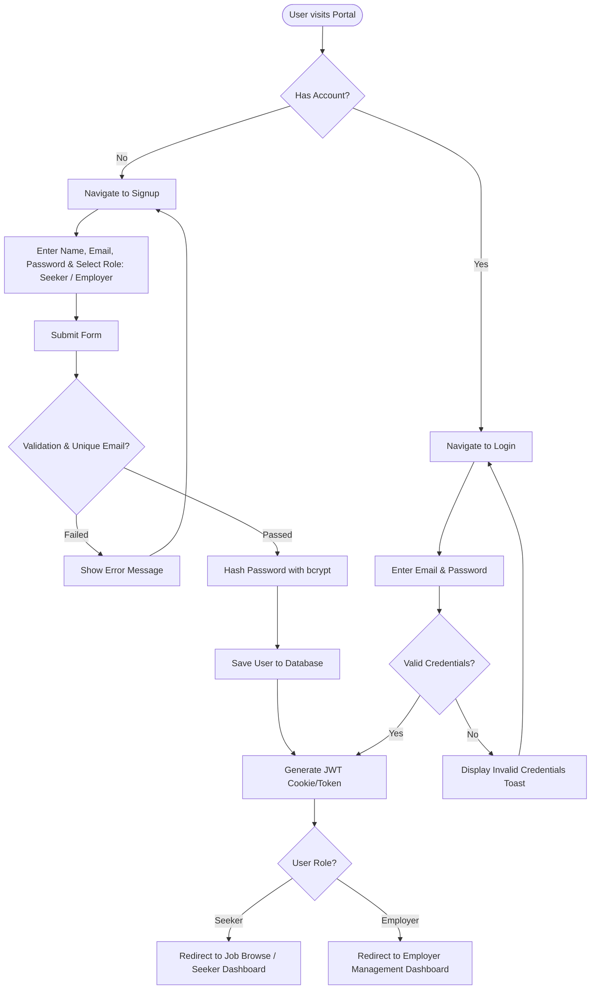
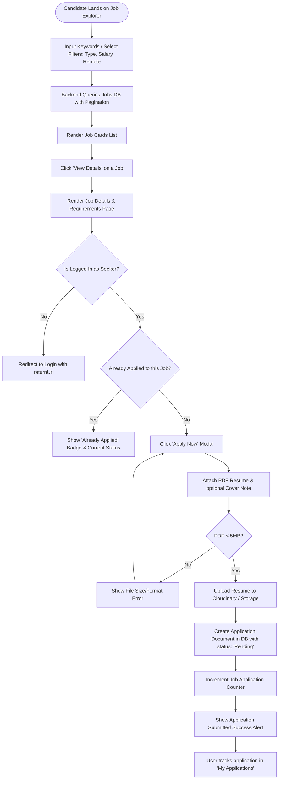
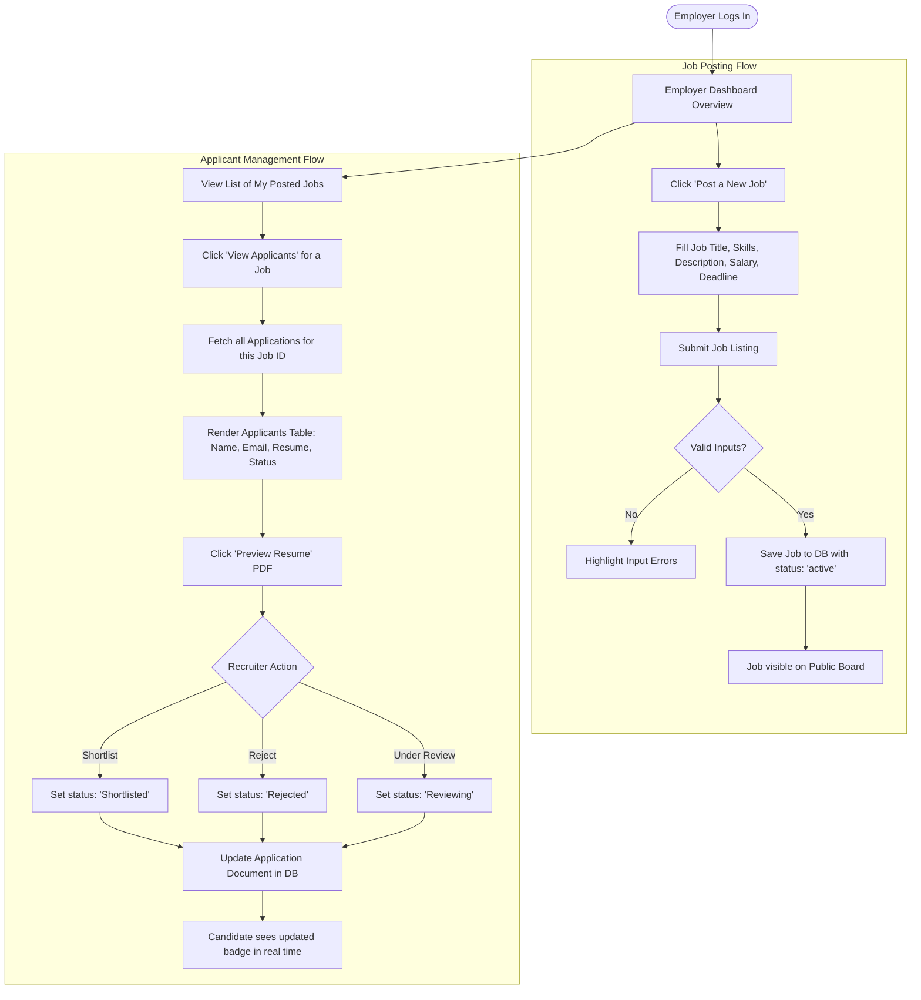
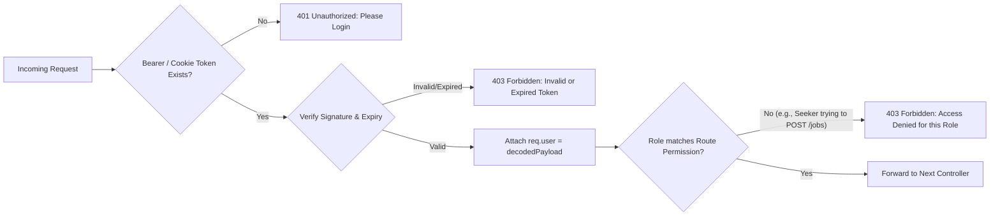

# User & System Flow Architecture

This document maps out the operational workflows, user interactions, and state transitions across the **NextHire** portal.

---

## 1. Authentication & Role Selection Flow



---

## 2. Job Seeker Journey: Discovery to Application



---

## 3. Employer Journey: Post Job & Candidate Review (ATS Flow)



---

## 4. Protected Route & Token Verification Flow

Every API call to sensitive resources passes through the RBAC Middleware:



---

## 5. Application Status State Machine

```
              ┌───────────────┐
              │    Pending    │ (Initial state on submit)
              └───────┬───────┘
                      │
                      ▼
              ┌───────────────┐
              │ Under Review  │ (Recruiter opened resume)
              └───────┬───────┘
                      │
             ┌────────┴────────┐
             ▼                 ▼
     ┌───────────────┐ ┌───────────────┐
     │  Shortlisted  │ │   Rejected    │ (Final terminal states)
     └───────────────┘ └───────────────┘
```
